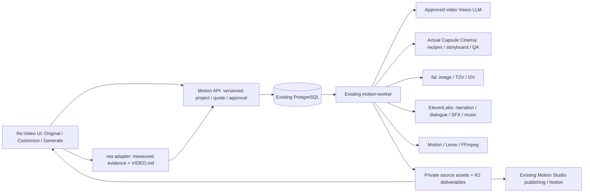

# Architecture audit — 13 พฤศจิกายน 2026

## ระบบที่ตรวจจริง

- Re:Video: repo kerverme/stream-house-explore, feature branch codex/fal-all-t2v-20261113, runtime 02768169, Railway deployment 7271f27e SUCCESS; UI 3 ขั้นและ 120 model options ต้องรักษาไว้
- Motion: repo kerverme/motion-studio main, audited commit a49f98928d63fa640e45f2ad20173ca41a4a087b. motion-api และ motion-worker กำลัง build งานเดิมขณะเริ่ม audit; ไม่ยกเลิกหรือเขียนทับงานนั้น
- motion-api: Hono/TypeScript, password/session auth + bearer API auth, migration ledger, PostgreSQL, signed S3 assets, OpenAI planning, fal + ElevenLabs quotes, Buffer และ Notion
- motion-worker: Python 3.12, PostgreSQL SKIP LOCKED/heartbeat, resumable stage_results, FFmpeg, code rendering, ElevenLabs alignment/SFX/music, fal text/image-to-video pipeline, R2 delivery
- lemo-worker เป็น logical service ที่ยังไม่มี live deployment ใน inventory ที่อ่าน; lemo-render-executor เป็น private Railway Function ที่มี SUCCESS deployment. ความพร้อมใช้จริงต้องดู release gates ไม่อนุมานจากชื่อ service
- PostgreSQL 18 มี service/volume เดิม. schema ที่ audit มาจาก migrations และ tests ของ repo ไม่ได้แก้หรืออ่าน production rows โดยตรง

## Source และ license

- rea-video เดิมติดตั้งจริงจาก vendored source 2132c8503301fdc4f30b68539272f922f7d751ae พร้อม local patches เรื่อง timing/security
- rea-video upstream ล่าสุดที่ clone: ab8580e38a1255425b0d3b481866590766932079, package 0.1.0, Apache-2.0, มี VIDEO.md/videomd 1.1+ และ audio/ASR additions
- capsule-cinema source จริง: 97229260c96ee8a3fb37db83027bbc1aefd8f073, runtime 2.0.0, Apache-2.0; มี Python CLI + Agent Skill ไม่ใช่ HTTP server
- อ่าน skill/installation และ API จริงแล้ว จะใช้ supported functions/CLI และ tool_factory hook ผ่าน adapter ไม่ใช้ paid runtime runners ข้าม ledger

## เหตุที่แยกช็อตได้ แต่ผู้ใช้ไม่เห็น Reverse Prompt

Local ingestion ทำ deterministic analysis โดยไม่ใช้ VLM จึงให้เวลาช็อต/ภาพ/heuristics ได้ แต่ไม่ใช่ semantic description. Shot Lab มี video-understanding stage จริงผ่าน openrouter/router/video หรือ fal-ai/video-understanding หลัง quote/approval เท่านั้น และมี JSON field validation/partial/uncertainty. การเห็น shot breakdown ไม่ได้แปลว่า Vision stage ทำงานแล้ว

FAL_KEY ไม่อยู่ในชื่อ environment variables ของ Re:Video ที่ Railway รายงาน แต่เว็บมี private settings ของตัวเอง จึงยังสรุปไม่ได้ว่าไม่มีคีย์. Motion มี FAL_KEY, OPENAI_API_KEY, ELEVENLABS_API_KEY และ credentials ด้าน storage/Notion อยู่ในรายการ environment; audit ไม่พิมพ์ค่าและไม่อ้างว่า live provider ผ่านเพียงเพราะมีชื่อตัวแปร

ต้องทำสถานะสองขั้นให้ชัด เพิ่ม bridge ไปยัง Motion ที่จัดการ provider/ledger และเชื่อมผล semantic เข้าฉากของ Motion เวอร์ชันใหม่ โดยไม่เขียนทับฉากเดิม ไม่แทน measured timing ด้วยค่าที่โมเดลตอบ

## Baseline ก่อนแก้โค้ด

- Re:Video: 519 passed / 2 skipped (upstream example media absent)
- Motion API: typecheck ผ่าน; 137 tests ผ่าน
- Motion worker: 44 passed / 1 skipped; 13 subtests ผ่าน
- Capsule CLI list/quickstart ใช้งานได้; pytest ที่ upstream เปิดให้ discover มี 1 test ผ่าน; จะเพิ่ม contract/integration tests แยก ไม่อ้างว่าเป็น paid-media QA
- rea-video ล่าสุด: ติดตั้งใน venv จริงและรัน CLI ได้; full upstream tests ผ่าน 266 tests

## สิ่งที่จะใช้ซ้ำและข้อขัดแย้งที่ต้องกัน

1. Motion เป็น job/production-state authority; เพิ่มตารางแบบ additive และ worker task routing โดยไม่แทน motion-api/motion-worker
2. Re:Video เก็บ evidence/timing/UI เดิม; source data ยังคงแยกจาก remake assets
3. ใช้ Motion creative approvals/calls/cache สำหรับ paid dispatch; unknown cost และ unknown POST outcomes ห้ามส่งใหม่อัตโนมัติ
4. Capsule เรียกได้เฉพาะ planning/recipe/validation ใน subprocess ที่ไม่มี provider secrets; การสร้างเงินจริงผ่าน Motion adapters ที่ผูก ledger เท่านั้น
5. แยก dependencies ของ latest rea/capsule จาก Python worker ปัจจุบัน ป้องกัน OpenCV, numpy, pydantic/crewai conflicts
6. R2 delivery เดิมอาจเป็น public media domain จึงห้ามอัปโหลด source/plaintext reference โดยถือว่า presigned URL ทำให้ private; ต้องใช้ private storage หรือ encryption/access-controlled delivery ที่ตรวจสอบได้
7. VIDEO.md เป็น upstream format; normalized schema เก็บ frame/PTS precision แยก ไม่เอาเวลาที่ปัดเพื่อแสดงผลกลับไปเปลี่ยนต้นฉบับ
8. ไม่เรียก upstream remake-run/assemble หรือ generic capsule generation ที่อาจ reuse source assets/เรียก paid tool โดยตรง
9. Live Vision acceptance ต้องมีคลิปจริง, quote และ approval ที่ตรวจสอบได้ก่อนส่ง; mock tests ไม่ใช่หลักฐาน semantic quality

## เป้าหมาย integration

