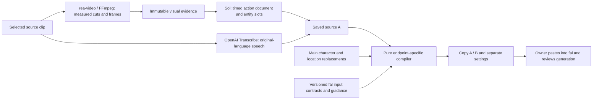

# Model-aware Prompt A/B exports

The generic forensic prompt is still the immutable source record. The focused
UI now compiles a separate, read-only export for the chosen fal endpoint. It
does not ask an LLM to rewrite action directions when changing models or B.

## Contracts and craft

`api/config/prompt-export-catalog.json` records the complete 120-entry
text-to-video category, checked 15 November 2026 through fal MCP. Of these,
102 returned input schemas; 18 returned no usable schema and remain visible,
blocked for export. Entries requiring references, voices, LoRAs or an
unsupported duration remain visible with specific blockers. A catalog listing
does not imply that a text-only request is executable.

Published sources read for this change:

- fal `h3-cinematic-prompter`, version `da29slkregj71ml15p6g`, including
  `references/format-spec.md` from that same version.
- fal `fal-shot-craft`, version `dbhe8nsregj9nths9grg`.
- Live endpoint input contracts, prompt descriptions and model knowledge;
  each catalog row records its exact fal API documentation URL.

H3 uses the three-field picture/sound/music format, original-language dialogue
tags when language metadata is available, and disabled prompt expansion. Kling
puts the opening and camera before ordered actions. Other endpoints use
factual, self-contained subject/location/action/camera/light/end-state prose
and their own schema controls. This is a universal craft fallback where no
separate family grammar was published, not a claim of bespoke guidance for
every catalog variant.

Source fidelity takes precedence over the guides' creative defaults. We do
not force animation into live action, round source cuts onto H3's half-second
grid, remove actions to meet a recommended shot budget, trim dialogue or
invent speaker identities and voices. Those adaptations are disclosed. The
live H3 schema accepts fractional durations from 0.92 to 15 seconds; it takes
precedence over the older creative guide's integer 5–15 second rule.

## Invariants and limits

- Export checks the stored motion hash, scopes versions to the authenticated
  project, never updates saved A/B and never calls a paid provider.
- A/B share exactly the same direction block, timings, camera, lighting,
  style, props and dialogue. Only the selected main character and location
  descriptions differ. Supporting characters return to A's descriptions.
- Whole-range export retains the transcript. Subshot exports rebase times
  without assigning an untimed whole-range transcript to an arbitrary shot.
  The UI offers free preparation of that shot, followed by the normal priced
  approval flow for new visual/speech analysis.
- Preserve supported source aspect ratio. Never silently crop or truncate.
  A longer minimum model duration adds an explicit final-pose hold, with
  manual trim instructions; actions are not rescaled. Unverified duration,
  unsupported aspect, required media, or overlong prompts block copying.
- Native speech support is checked separately. Kling v3's contract translates
  non-English/non-Chinese speech into English; the exporter disables that
  audio path and exposes the unchanged transcript separately.
- Model ordering uses the explicitly dated historical five-second, 9:16,
  audio-off preset comparison, with varying resolutions. It is not a current
  quote for the exported settings. Current fal prices must be checked before
  generation. The paid generation catalog is unchanged by this feature.
- New `action_v2` selections use measured-time gap filling, up to 12 fps with
  a 64-frame cap and every cut's opening/middle/closing anchors retained.
  Existing selections and paid evidence stay unchanged. The quote still
  accounts for the actual number of images sent. Visual interpretation is
  sampled-frame inference, not native video understanding or recovered
  original production parameters.

Text cannot guarantee identical frames, motion, speech or lip sync. A reference
or video-edit workflow supplies stronger evidence but still needs comparison
against the source. The UI links the verified H3 Max reference route (2–15s,
`reference_video_urls`, prompt alias `Video 1`) and Kling O3 Pro edit route
(3–15s, `video_url`, alias `@Video1`, `keep_audio`). These are manual handoffs,
not an implemented automatic source upload. No footage is submitted by export.

## Validation

Pure compiler tests cover A/B invariance, main-only replacement, original
dialogue, language limitations, aspect, duration, prompt length and per-shot
rebasing. API tests cover project/auth/hash boundaries and zero paid calls.
Worker tests cover measured frame anchors and immutable timing. A JSON Schema
audit checked every copyable result for a synthetic 2.9-second landscape shot
against its captured endpoint schema (120 entries inspected; zero schema validation errors for copyable results). Browser fixtures exercise real local compilation, copy,
model switching, draft retention, overflow blockers and mobile layout.

No paid inference or generation was performed during development. Tests do
not establish semantic extraction accuracy or visual reproduction quality.
