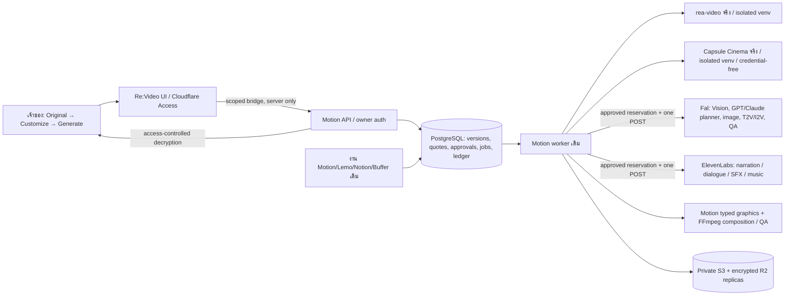

# Re:Video + Motion + rea-video + Capsule Cinema

สถานะ 13 พฤศจิกายน 2026: ติดตั้ง source จริงและ adapter แล้ว การทดสอบ Vision/ภาพ/วิดีโอ/เสียงแบบเสียเงินต้องมีใบราคาและเจ้าของยืนยันก่อน รายงาน local/mocked tests ไม่ใช่หลักฐานคุณภาพจากผู้ให้บริการจริง ดู ACCEPTANCE.md และบันทึก deployment ประกอบ

## สถาปัตยกรรม



Motion เป็นเจ้าของสถานะใหม่ทั้งหมด Re:Video เก็บเพียง project binding และรักษาโปรเจกต์/ประวัติเก่าไว้ ไม่มีการแก้ original timeline ของงานเดิม การเชื่อมโปรเจกต์จะวิเคราะห์สำเนาใหม่ด้วย upstream ล่าสุด งานเดิมยังเปิดผ่าน “เครื่องมือเดิมและประวัติรายช็อต” ได้

Source จริงที่ pin ไว้:

- rea-video `ab8580e38a1255425b0d3b481866590766932079` (0.1.0, Apache-2.0)
- capsule-cinema `97229260c96ee8a3fb37db83027bbc1aefd8f073` (2.0.0, Apache-2.0)

Docker build clone source ตาม SHA พร้อม LICENSE ติดตั้งใน venv คนละชุดและ link Agent Skills ใต้ `/opt/motion-upstreams/skills/` ไม่แทนที่ Python ของ worker เดิม ไม่มี `.env` หรือ provider keys ส่งเข้า Capsule/rea subprocess ตรวจ runtime version ผ่าน heartbeat ไม่ดาวน์โหลดหรือเรียก paid provider ตอน startup

## ขั้นตอน

1. เปิด Re:Video โปรเจกต์เดิม → เริ่มใช้กับคลิปนี้ → แยกฉากด้วย rea-video (ไม่เสียค่าโมเดล) เก็บต้นฉบับ/frames/stems/VIDEO.md และ frame indices/PTS เต็ม
2. เปิดฉาก → ให้ AI อ่าน → ตรวจราคา/สิ่งที่จะส่ง → ยืนยัน Gemini ผ่าน `openrouter/router/video` รับคลิปจริงของฉาก ไม่ใช้ T2V เป็น Vision ไม่มีเสียงในคลิปที่ส่ง และอาจเล่นช้าลงให้ sampling เห็นช็อตสั้น
3. ร่างที่ได้เป็น model-estimated, needs_review เสมอ ไม่ตั้ง human review แทนเจ้าของ แสดงตัวละคร ตำแหน่ง props actions กล้อง แสง opening/ending uncertainty และ English reverse prompt
4. Customize → เปลี่ยนตัวละคร/สถานที่ → สร้างข้อความจากช่องที่แก้ → อ่านและบันทึก → ทดลองฉากเดียวหรือเลือกหลายฉาก
5. ทุก paid task ออก quote ผูก source/analysis/revision/model/prompt/price/key identity/expiry ก่อน reserve ใน creative ledger เดิม ไม่ทราบราคาจะหยุด
6. Preview/Technical QA/optional paid Vision QA → แก้ฉากที่ผิดแล้วขอ quote ใหม่เฉพาะฉาก ไม่ regenerate ทั้งเรื่องอัตโนมัติ
7. Assemble ต้องมี new generated assets ครบทุกฉาก ลำดับตามแผน ใช้ผลงานจากเวอร์ชันเก่าได้เมื่อ specification ของฉากนั้นเหมือนเดิม เก็บ output เป็น private asset ไม่ส่ง Buffer โดยอัตโนมัติ

รายการ T2V 120 endpoints มาจาก public Fal catalog ที่ตรวจ 13 พ.ย. เรียงราคาตาม duration ที่เลือก มี maintained preset/schema/price ที่ใช้งานได้ 59 รายการใน Motion ณ snapshot (รายการเดิมของ Re:Video มี adapter เพิ่มเติม) รุ่นที่ราคา/ความสามารถยังไม่ยืนยันจะแสดงเหตุผลและถูกบล็อก วันหมดอายุของราคาต้องมีการ refresh metadata ไม่เปลี่ยนค่าตั้งแล้วใช้ราคาเก่า H3 Max/Grok I2V ใช้ adapter เดิมที่ตรวจแล้ว เลือกภาพใหม่หรือ last frame ที่สร้างใหม่อย่างชัดเจน ไม่ส่ง original pixels/voice ให้ generation โดยปริยาย

Planner รับเนื้อหาจริงของ read-order resources ที่ผ่าน Capsule validation พร้อม hash และ lifecycle plan ไม่ได้รับเพียงชื่อสูตร. Planner ใช้ GPT/Claude ผ่าน Fal OpenRouter route โดยไม่ต้องเพิ่ม OpenRouter key ใช้ Fal key เดิม ตัว planner อ่าน VIDEO.md + normalized evidence + instructions + selected Capsule recipe เป็นแผนเดียว versioned ไม่มี agent หลายตัวเขียนแผนแข่งกัน Existing direct OpenAI Motion planning ยังอยู่ตามเดิม

Capsule ใช้ supported Python APIs `normalize_video_analysis`, `materialize_capsule_from_draft`, validator และ `build_dispatch_plan` จริง ใช้ lifecycle/recipe resources เป็น planning contract ห้าม `execute_dispatch_plan`, `local_script` หรือการเรียก provider จาก Capsule งาน production ส่งผ่าน Motion เท่านั้น `validated` หมายถึง upstream schema ผ่าน ไม่ได้แปลว่าทดสอบ production/identity ด้วยคนแล้ว Episode deny-literals ใช้เฉพาะตอน audit แล้วลบออกจาก recipe package ที่เก็บถาวร ไม่เก็บชื่อส่วนตัวแม้แต่ใน forbidden list. สูตรใหม่ไม่เขียนทับสูตรเก่า มี version และ hash ของเนื้อหา recipe resources จริง (ไม่ใช่เฉพาะ metadata) แยก project literals ออกจาก reusable rules

## API

Owner API หรือ scoped server bridge: `/app/api/reverse` ทุก route private/no-store

- `GET /config`: runtime versions, configured flags, model metadata, recipes (ไม่เรียกผู้ให้บริการ)
- `POST /projects`: `{origin_key,title,source:{sha256,bytes,filename,content_type}}` idempotent by origin
- `PUT /projects/:id/source`: raw binary, exact SHA/bytes, encrypted upload
- `POST /projects/:id/analyze`: `{audio,ocr,asr}` enqueue deterministic analysis only
- `GET /projects/:id`: measured/semantic shots, current plan, assets, jobs
- `PUT /projects/:id/plan`: strict `motion.reverse.production.v1`, optimistic base_revision, immutable history
- `GET /projects/:id/versions`: authoritative revisions
- `POST /projects/:id/reference`: raw owned image + `x-reference-metadata` JSON with hash/bytes/type/rights
- `POST /projects/:id/quote`: purpose `vision|planner|image|generate|repair|visual_qa`, shot_ids, optional model/instructions/asset_id/recipe_id
- `POST /projects/:id/approve`: exact quote_id/binding/amount + source/rights confirmations
- `POST /projects/:id/recipe`: reviewed generic recipe; actual upstream validation/plan; no paid calls
- `POST /projects/:id/assemble`: revision + exact new shot asset map + rights confirmation
- `GET /assets/:id`: authenticated decryption after checksum/tag validation (never plaintext public source URLs)
- `POST /jobs/:id/resume`: accepted-ID/local resumes only; unknown paid POST blocks

Schema: API `reverse-contract.ts`; worker `reverse-schemas.json` generated from the same Zod schema. Changing it requires regenerating worker schema and rerunning contract tests.

## Secrets / storage / migration

Add only new names to Railway; preserve existing keys:

- `MOTION_REVERSE_BRIDGE_TOKEN`: Motion API + Re:Video only; namespace-scoped, never browser
- `MOTION_REVERSE_URL`: Re:Video → existing Motion HTTPS domain; cross-project Railway private DNS is not assumed
- `MOTION_REVERSE_STORAGE_KEY`: 32-byte AES key as 64 hex chars; same on Motion API/worker, keep for all old encrypted versions and rollback
- Existing FAL_KEY on Motion API/worker; ELEVENLABS_API_KEY on worker; existing BUCKET*, R2*, DATABASE_URL unchanged
- ElevenLabs prices reuse `MOTION_CREATIVE_RATES_JSON` per category, with model, usd_per_unit, source, checked_at, valid_until. narration unit characters (also dialogue), sfx seconds, music track. Unknown/stale/model-mismatched prices block, never assume free. Preferred TTS/SFX and voice ID remain configured values; actual speech model/voice availability checked by read-only GET before POST.

Migration `028_reverse_production.sql` only adds reverse_projects/assets/versions/quotes/approvals/steps/recipes and indexes. It does not rewrite/delete any existing draft, job, episode or provider ledger. Actual spending uses existing creative_approvals/creative_calls/creative_cache under transactional locks. Reverse approval is UI provenance, not another independent financial ledger.

Unknown POST remains reserved/uncertain, no automatic re-POST. Saved Fal IDs are polled via bounded GET. Raw paid response is encrypted before semantic/QA validation; malformed outputs do not cause another charge. Cached media/analysis is reused; missing cached evidence blocks regeneration pending restore. Costs are estimates, not provider-side hard caps; reconcile actual token usage when reported and stop further spending if above reservation. No paid repair loops.

Original plaintext stays out of public R2 delivery. AES-256-GCM ciphertext has private S3 primary + encrypted R2 replica; decryption uses authenticated API. Source upload is mirrored by the analysis worker. Keep DB + storage key + ciphertext in backups. Old legacy delivery/publishing paths are preserved.

## Local verification

```bash
cd api
npm ci
npm run typecheck
node --import tsx --test src/*.test.ts
cd ..
PYTHAINLP_DATA_DIR=/workspace/work/pythainlp-data MOTION_REA_ROOT=/path/to/actual/rea-video MOTION_CAPSULE_ROOT=/path/to/actual/capsule-cinema .venv/bin/python -m pytest -q worker/tests
```

At the deployment smoke checkpoint, actual local/Railway decomposition and actual Capsule validation/planning passed without paid calls. Source prompt composition uses validated Vision fields with measured source times; raw model prompt is retained separately. Delivery uses cumulative 30fps quantization to prevent accumulated timeline drift.

See ACCEPTANCE.md for separation of local/provider evidence. A browser fixture is not proof of Gemini scene accuracy. Character ID matches are estimates with distinctive evidence; reading subsequent shots after the first registry is established supplies known identity context. Initial batch matching is conservative and may produce separate IDs requiring review. Models do not guarantee perfect identity or continuity.

## Rollback

Deploy previous pinned commits back to the SAME services. Keep database tables, volumes, provider journals, ciphertext and storage key. Do not run destructive down migrations. Do not requeue unknown POSTs. Existing worker can ignore terminal reverse jobs; before reverting worker, stop new reverse submissions and let active reverse jobs finish/cancel so an older worker cannot claim an unknown kind. Re:Video bridge can be disabled by removing only MOTION_REVERSE_URL; legacy UI/history remains. No DNS changes needed.
