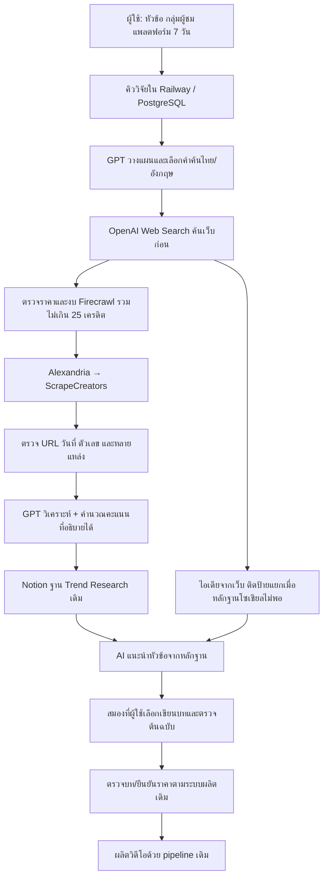

# รายงานย้ายระบบค้นหาเทรนด์เป็น Firecrawl Alexandria

ตรวจวันที่ 15 พฤศจิกายน 2026 เวลาประมาณ 13:55 น. กรุงเทพฯ

**ระบบใหม่ deploy แล้ว และเส้นทางค้นเว็บ → แนะนำหัวข้อ → เขียนบท ใช้ได้จริง แต่การย้ายออกจาก Jev ยังไม่เสร็จครบ เพราะ Firecrawl ปฏิเสธการดึงโซเชียลด้วย `insufficient_credits` ยอดคงเหลือที่ API รายงานคือ -141 เครดิต จึงยังไม่รับรองการดึง TikTok/Instagram และยังไม่ลบบริการเดิม**

## A. สิ่งที่ทำและสถานะจริง

- ตรวจ main, branches, services, pending changes และโค้ดเดิมก่อนแก้ สร้าง branch `feat/alexandria-trend-research` จาก production ล่าสุด
- ระหว่างทำพบ production เปลี่ยนอีกครั้ง จึงรวม commit `27a3bd8ed2987992d201bd2b471d240206e173a5` ซึ่งเพิ่ม Scene Director/Video Inspector ไว้ครบก่อน deploy API
- เพิ่ม worker ใหม่ใน repository เดิม ใช้ Node และ HTTP API ไม่มี Chrome, Socai หรือ Jev ใน image ใหม่
- ตรวจ API และราคาจากเอกสารทางการ รวมทั้งเรียก catalogue ด้วย key จริงสำเร็จ: ScrapeCreators 43 เครื่องมือ และ Oriane 8 เครื่องมือ
- ตรวจบัญชีจริงว่าเข้าถึงโมเดลที่ตั้งค่า `gpt-6.1-terra` ได้ โมเดลวิจัยเปลี่ยนผ่าน configuration ได้ และตรวจสิทธิ์ก่อนใช้
- เพิ่มงบถาวร 25 เครดิตต่อ Research Job การสำรองก่อนเรียก การใช้แคช การหยุดเมื่อผลการคิดเงินไม่แน่นอน และการกันคำขอซ้ำข้ามแท็บ/รีโหลด
- แบ่งข้อมูลเว็บ ตัวเลขที่ผู้ให้บริการรายงาน ความเห็นของ AI และข้อมูลที่ขาดออกจากกัน เทรนด์ต้องมีโพสต์เรื่องเดียวกันจากผู้สร้างอย่างน้อยสองราย
- ขยาย Notion ฐานเดิมด้วย Provider, Research Model, Category, Verification, Confidence, Estimated Credits, Actual Credits และ Supporting Sources; เพิ่มตัวเลือก YouTube โดยคงข้อมูลเดิม
- เพิ่มหน้า Discover Trends, Last 7 Days, หัวข้อค้นหา/กลุ่มผู้ชม, ตัวเลือกแพลตฟอร์ม, แหล่งข้อมูล, คะแนนและค่าเครดิต รวมถึงโหมด Web Research ที่ไม่อ้างว่าเป็นเทรนด์โซเชียล
- ทดสอบหัวข้อจากเว็บจริง 10 หัวข้อ แล้วเลือกหนึ่งหัวข้อให้เขียนบทจนพร้อมตรวจ พร้อมเปิดต้นฉบับตรวจซ้ำและใช้งบวิจัยเดิมต่อ
- งานทดสอบตั้ง `auto_produce=false`; ไม่มี episode/video-production job หรือการเผยแพร่ใหม่จากการทดสอบนี้
- ยังไม่ถอด `trend-worker/`, dependencies/variables ของ Jev หรือ Railway service เดิม เพราะข้อกำหนดในงานให้เก็บไว้จนระบบใหม่ผ่านการดึงโซเชียลจริง บริการเดิมปิด schedule อยู่ และ UI ใหม่ใช้คิว Alexandria แยกต่างหาก

**Production ที่ deploy:** runtime commit `deea5518497d77e8b44b9eeb822bb1e9ec00f333`

| บริการ | Deployment | ผลตรวจ |
|---|---|---|
| motion-api | `b335f569-5c5a-4675-b883-163ae87a98d4` | SUCCESS, `/health` HTTP 200 |
| alexandria-trend-research | `45623f62-d94d-4a56-af07-51d8683b60c1` | SUCCESS, heartbeat ทำงาน, ไม่มี worker error |
| motion-worker | `6ed26745-b638-4dff-abcd-39cce04bbaf8` | Online; คง deployment งานล่าสุดของเดิม |
| jev-trend-research | `631e3fe9-f818-4482-94c7-97df45531817` | เก็บไว้ระหว่างรอผ่านเงื่อนไขถอดระบบ |
| Lemo worker, provider-check, render-executor, Postgres | deployment เดิม | Online |

รวม 8 services Online ไม่มี pending deployment changes ในเวลาตรวจ แต่สถานะ Online ไม่ใช่หลักฐานว่าโซเชียลดึงได้สำเร็จ

Migration ใหม่ `032_alexandria_research.sql` และ `033_alexandria_request_aliases.sql` ใช้งานใน production แล้ว เก็บ migration `032_reverse_scene_logic.sql` ของงานที่เพิ่มพร้อมกันไว้ด้วย ระบบติดตาม migration ตามชื่อไฟล์เต็ม

## B. เปรียบเทียบของเดิมและของใหม่

| เรื่อง | Jev Social เดิม | ระบบ Alexandria ใหม่ |
|---|---|---|
| วิธีอ่านโซเชียล | ควบคุม browser ผ่าน Socai | เรียก API ของผู้ให้บริการผ่าน Firecrawl |
| TikTok/Instagram login | การทดสอบเดิมติด login/access | เส้นทาง API ปกติไม่ต้องใช้บัญชีโซเชียลส่วนตัว; รอบนี้ติดเครดิต |
| งานพื้นหลัง | Chrome + Socai + Jev | worker Node และ PostgreSQL |
| ค้นหาข้อมูลทั่วไป | การสำรวจเว็บ/หน้าโซเชียล | OpenAI Web Search ก่อนเสมอ |
| ตรวจราคา | ค่าใช้ GPT และ browser | ตรวจราคาของเครื่องมือก่อนเรียก สำรองในงบรวม 25 เครดิต |
| หลักฐานเทรนด์ | เน้นโพสต์และความนิยมรายโพสต์ | ต้องมีหลักฐานสอดคล้องจากหลายผู้สร้าง พร้อมคำอธิบายคะแนน |
| ข้อมูลไม่พอ | Creative fallback | แยก Creative, Web Research และ Trending ชัดเจน |
| ความพร้อมวันนี้ | การเข้าถึงโซเชียลเดิมยังติดข้อจำกัด | เว็บและเขียนบทผ่านจริง; โซเชียลยังรอเครดิต |

## C. เส้นทางการทำงาน

รอบทดสอบจริงเดินผ่านแขนงข้อมูลเว็บ ส่วนแขนง Alexandria → หลักฐานโซเชียล → Notion ยังไม่ผ่านการทดสอบจริง เพราะเครดิตไม่พอ

## D. แต่ละส่วนทำอะไรและคิดค่าใช้อะไร

| ส่วน | หน้าที่/เหตุผล | API หรือที่ทำงาน | GPT tokens | Firecrawl credits |
|---|---|---|---|---|
| หน้า Studio | รับความต้องการและแสดงหลักฐาน/ค่าใช้ | Browser + motion-api บน Railway | ไม่ใช้โดยตัวหน้า | ไม่ใช้โดยตัวหน้า |
| คิวและบัญชีงบ | กันงานซ้ำ เก็บสถานะและงบให้รอดหลังรีสตาร์ท | Railway + PostgreSQL | ไม่ใช้ | ไม่ใช้ |
| GPT Planner | เข้าใจหัวข้อและเลือกคำค้น/เครื่องมือ | OpenAI; บัญชีตรวจผ่าน Terra | ใช้ | ไม่ใช้ |
| Web Search | ค้นข่าว แหล่งสาธารณะ และต้นฉบับก่อนเรียกโซเชียล | OpenAI Web Search | ใช้ร่วมกับโมเดล และมีค่าค้นแยก | ไม่ใช้ |
| Catalogue/ยอดคงเหลือ | อ่านความสามารถ ตัวเลือก ราคา และเครดิตที่มี | Firecrawl API | ไม่ใช้ OpenAI tokens | discovery ฟรี; ยอดคงเหลือเป็นการอ่านบัญชี |
| ดึงข้อมูลโซเชียล | ขอข้อมูลโพสต์และตัวเลขที่เว็บค้นทั่วไปให้ไม่ครบ | Firecrawl Alexandria → ScrapeCreators | ไม่เรียก OpenAI ด้วยตัวมันเอง | ตามเครื่องมือ สูงสุด 2 ต่อครั้งที่ผ่านการตรวจ |
| ตรวจหลักฐาน | ตรวจชื่อโดเมน/ID วันที่ 7 วัน และคำอ้างอิงที่อยู่ในเนื้อหาจริง | โค้ดบน Railway | ไม่ใช้ในขั้นตรวจแบบกฎ | ไม่ใช้เพิ่ม |
| วิเคราะห์/ให้คะแนน | จัดกลุ่มเรื่องและประเมินความเหมาะสม จากนั้นคำนวณคะแนน/ความมั่นใจ | GPT + โค้ด Railway | ใช้ในส่วนตีความ | ไม่ใช้เพิ่ม |
| เก็บ Notion | เก็บหลักฐาน คะแนน เวลา โมเดลและค่าเครดิต ตรวจซ้ำก่อนสร้างหน้า | Notion API + PostgreSQL | ไม่ใช้ | ไม่ใช้ |
| สุ่มหัวข้อ | เสนอหัวข้อให้เจ้าของเลือกโดยอ้างถึงหลักฐานที่มี | OpenAI integration เดิม | ใช้ | ไม่ใช้เพิ่ม |
| เขียนบท | เปิดต้นฉบับอีกครั้ง แล้วใช้สมองที่ผู้ใช้เลือก | motion-api + OpenAI | ใช้ | หากจำเป็นต้องดึงข้อมูลเพิ่ม จะนับในงบวิจัยเดิม |
| ผลิตวิดีโอ | วาด/สร้างภาพเคลื่อนไหว พากย์ ใส่เสียง และประกอบคลิป | pipeline เดิม Railway/fal/ElevenLabs ตามโหมด | บางโหมดใช้ | ไม่ใช่ค่า Alexandria; ค่าผลิตแยกและใช้เงื่อนไขอนุมัติเดิม |

การระบุว่าไม่ใช้ GPT tokens/Firecrawl credits ไม่ได้หมายความว่า Railway, Notion หรือบริการผลิตวิดีโอไม่มีค่าบริการตามแพ็กเกจ

## E. ตัวอย่าง “ค้นหา 10 เทรนด์ TikTok และ Instagram ในไทยย้อนหลัง 7 วัน แล้วเลือกดีที่สุดเขียนบท”

1. ผู้ใช้เลือก TikTok + Instagram, ใส่หัวข้อและกลุ่มผู้ชม แล้วกด Discover Trends ระบบเก็บรหัสคำขอเพื่อป้องกันการสร้างซ้ำ
2. GPT ค้นเว็บก่อน เพื่อหาเรื่องและแหล่งข้อมูลในช่วงเวลาเป้าหมาย แล้ววางคำค้นไทย/อังกฤษ แต่ละแพลตฟอร์มใช้ได้ไม่เกินสองคำค้น ไม่มีการไล่หน้าค้นไม่สิ้นสุด
3. ระบบตรวจ catalogue และเครดิตก่อนขอข้อมูลจริง การค้นอาจคืนโพสต์เก่า จึงตรวจวันที่โพสต์ทีละรายการอีกครั้ง ตัวกรองประเทศหรือ region ไม่ถือเป็นหลักฐานว่าผู้ชมอยู่ไทยทั้งหมด
4. เมื่อดึงได้ ระบบอ่าน caption, URL, ผู้สร้าง, วันที่, views/likes/comments ที่มีจริง ข้อมูลที่ไม่มีจะเว้นว่าง ไม่เติมเลขศูนย์ และไม่สร้างประวัติการเติบโตจากตัวเลขครั้งเดียว
5. GPT จัดกลุ่มเรื่องเฉพาะที่พบจากหลายผู้สร้าง ระบบตรวจคำอ้างอิงจริงและคำนวณคะแนน เก็บเหตุผล ข้อจำกัดและหลักฐานใน Notion แล้วเสนอหัวข้อจากกลุ่มที่ผ่านเกณฑ์
6. ถ้าได้ไม่ครบ 10 จะรายงานจำนวนจริง ถ้าไม่มีเทรนด์ผ่านเกณฑ์ ผู้ใช้เลือก Web Research หรือ Creative ได้ โดยมีป้ายแยกชัดเจน
7. เลือกหัวข้อเพื่อเขียนบท ระบบแนบต้นทางและตรวจแหล่งจริงซ้ำ โดยไม่เปิดงบ Firecrawl ใหม่อัตโนมัติ หากเป็นข้อกล่าวอ้างสุขภาพ ต้องตรวจหลักฐานต้นฉบับและไม่เปลี่ยนความสัมพันธ์ทางสถิติเป็นเหตุและผล

**สิ่งที่เกิดขึ้นจริงในรอบนี้:** งานวิจัย `e800bbfb-5cb6-4740-b357-7dec9cd76856` ได้ข้อมูลข่าวเว็บเกี่ยวกับสุนัข แต่การขอโซเชียลทั้งสองแพลตฟอร์มถูกปฏิเสธ จึงมีเทรนด์ที่ยืนยันได้ **0** เรื่อง ไม่ได้สร้างข้อมูลทดแทน จากนั้นสร้างหัวข้อ Web Research จริงครบ **10** หัวข้อ และเลือก “สุนัขตัวใหญ่แก่เร็วกว่าเพื่อนจริงไหม?” ไปเขียนบท

ร่าง `5740a900-573f-4553-8ccb-edb0bcddeadb` อยู่สถานะ `ready`, ใช้ Terra, มี 7 ช่วงบท อ่านบทคัดย่อต้นฉบับใน PubMed และระบุข้อจำกัดว่าความสัมพันธ์ยังไม่พิสูจน์เหตุและผล ไม่ส่งผลิตอัตโนมัติ ไม่มี episode ใหม่ งบวิจัยยังเป็น `9d1cb395-6532-4316-934b-8c6b76fc36f7` เดียวกับงานค้นหา

## F. ราคาและงบ

ราคาที่ตรวจจาก catalogue จริงวันที่ 15 พฤศจิกายน 2026:

| รายการ | Firecrawl credits |
|---|---:|
| ค้นรายการเครื่องมือ `firecrawl/find-tools` | 0 |
| ScrapeCreators: TikTok search/video, Instagram search-reels/post, YouTube search/video ที่ตรวจแล้ว | สูงสุด 2 ต่อครั้ง |
| Oriane: basic | 35 ต่อคำขอที่ได้ผลลัพธ์ |
| Oriane: default / full | 50 / 65 ต่อคำขอที่ได้ผลลัพธ์ |

Oriane จึงไม่ถูกเลือก เพราะแม้ระดับ basic ก็เกินเพดาน 25 เครดิต ไม่ได้ตีความราคา 50 ในหน้ารายการว่าเป็นเพดาน หากเครื่องมือเปลี่ยนราคา/ตัวเลือก ระบบจะปฏิเสธจนตรวจราคาใหม่

**ตัวอย่างงบจากราคาที่ตรวจแล้ว:** ค้น 4 ครั้ง × 2 = 8 เครดิต แล้วอ่านรายละเอียดได้อีกไม่เกิน 8 ครั้ง × 2 = 16 เครดิต รวมเพดาน **24 เครดิต** เหลือ 1 เครดิต ซึ่งไม่พอเรียกเครื่องมือราคา 2 อีกครั้ง นี่เป็นตัวอย่างจัดงบ ไม่ใช่คำรับประกันว่าจะได้ 10 เทรนด์

**การทดสอบจริง:** รุ่นก่อนเพิ่มการตรวจยอดคงเหลือส่งคำขอโซเชียล 4 ครั้ง และบันทึกวงเงินสูงสุดไว้ 8/25 เครดิต ทั้งสี่ครั้งตอบว่าเครดิตไม่พอ บัญชีงานไม่มีข้อมูลยืนยันค่าคิดเงินจริงครบ จึงแสดง **“ใช้จริงยังยืนยันไม่ได้”** ไม่รายงานว่าเสีย 8 หรือเสีย 0 แน่นอน รุ่นสุดท้ายเพิ่มการตรวจเครดิตก่อนเรียกและหยุดทันทีเมื่อพบข้อผิดพลาดนี้ ผลทดสอบจำลองยืนยันว่าเครดิตไม่พอแล้วไม่ส่ง paid social call

บัญชี Firecrawl รายงานโควตาแพ็กเกจ 1,000 เครดิต และยอดคงเหลือ -141 ณ 13:49 น. กรุงเทพฯ ต้องแก้ยอดเครดิตก่อนทดสอบต่อ ไม่มีการซื้อแพ็กเกจหรือเพิ่มงบให้อัตโนมัติ

OpenAI Planner/Web Search ของงานนี้มีต้นทุนประเมินใน ledger **$0.02741825** ซึ่งแยกจาก Firecrawl และยังไม่ใช่ยอดใบแจ้งหนี้ รวมทั้งไม่รวมค่าเขียนบทและการสุ่มหัวข้อ ค่าผลิตวิดีโอ/fal/ElevenLabs ไม่ได้เกิดจากการทดสอบนี้ ราคาดอลลาร์ต่อ Firecrawl credit ขึ้นกับบัญชี/แพ็กเกจ จึงไม่สมมติอัตราแลกเป็นเงิน

แหล่งราคาทางการ:
- https://docs.firecrawl.dev/features/alexandria
- https://docs.firecrawl.dev/api-reference/v2-openapi.json
- https://alexandria.firecrawl.dev/scrapecreators
- https://alexandria.firecrawl.dev/oriane

## G. หลักฐานการทดสอบ

| การตรวจ | ผล |
|---|---|
| TypeScript typecheck | ผ่าน |
| API automated tests รวมงานล่าสุดที่ merge | 220/220 |
| Worker regression: general story, reverse prompts, scene logic | 33/33 |
| Free catalogue + API authentication จริง | ผ่าน |
| การเข้าถึงโมเดล Terra จริง | ผ่าน |
| Notion runtime อ่านฐานและตรวจช่องใหม่ | HTTP 200, ไม่มีช่องขาด |
| Notion create/update/deduplication แบบจำลอง | ผ่าน |
| Notion บันทึกหลักฐานโซเชียลจริง | ยังไม่ผ่าน เพราะยังไม่มีข้อมูลโซเชียลจาก provider |
| TikTok/Instagram provider จริง | ถูกปฏิเสธ `insufficient_credits` |
| YouTube provider จริง/คอมเมนต์จริง | ยังไม่ได้เรียกทดสอบ |
| Web Research สร้าง 10 หัวข้อจริง | ผ่าน |
| ส่งหัวข้อไปเขียนบทและตรวจต้นฉบับจริง | ผ่าน; ready; auto_produce=false |
| ส่งคำขอวิจัย/หัวข้อ/ร่างซ้ำด้วยรหัสเดิม | คืนงานเดิม ไม่สร้างซ้ำ |
| ข้อมูลขัดกับ request ID เดิม | HTTP 409 |
| ไม่มีล็อกอิน / input ผิด | HTTP 401 / 422 ตามลำดับ |
| UI จริง: สลับโหมด เลือก Web Research แสดง/เลือก 10 หัวข้อ | ผ่าน; ไม่มี page error หรือ HTTP 5xx ระหว่างตรวจ |
| ผลิตวิดีโอใหม่จริงในรอบนี้ | ไม่ได้ทำ; ขอบเขตทดสอบจบที่บทพร้อมตรวจ |

Worker regression เคยติดสิทธิ์เขียนโฟลเดอร์ cache ของ PyThaiNLP ในเครื่องทดสอบ จึงตั้ง `PYTHAINLP_DATA_DIR` ให้เป็นโฟลเดอร์ workspace แล้วรันครบผ่าน โดยไม่แก้ logic ของ worker

Commit สำคัญ:
- `c49243e008b5d74ecb9532d7ae16fcf13be64301`: adapter/catalogue และงบขั้นแรก
- `425827287aa4fe4d45ede930032d18c0de8a9861`: orchestrator, UI, Notion, evidence และ script integration
- `7f7f056d9b3861a0404c1c76fa28178edfed7405`: รวมงาน production `27a3bd8` ที่เข้ามาระหว่างทำ
- **`deea5518497d77e8b44b9eeb822bb1e9ec00f333`: runtime ที่ deploy สุดท้าย**

ไฟล์หลักฐานแนบ: `verification.json`, `production-safety.json`, `api-tests.log`, `worker-tests.log`, `research-run.json`, `topic-result.json`, `draft-result.json`, `research-ui.png`, `web-topics-ui.png` และผลตรวจ UI ทั้งสองชุด

## H. ข้อสรุปความพร้อม

**ใช้ค้นข้อมูลเว็บ แนะนำหัวข้อ และเขียนบทได้แล้วบน production** ระบบควบคุมงบ คิว และการตรวจหลักฐาน deploy แล้ว พร้อมทดสอบจำลองครบ แต่ **ยังไม่พร้อมรับรองระบบค้น TikTok/Instagram เต็มรูปแบบ และยังย้ายออกจาก Jev ไม่ครบ** การ build หรือ Railway SUCCESS ไม่ได้ถูกใช้แทนผลทดสอบข้อมูลจริง

ขั้นตอนที่ยังต้องทำหลังแก้เครดิต Firecrawl: ดึงโพสต์จริงภายในงบ 25 ตรวจวันที่/ตัวเลข/หลายแหล่ง ยืนยันการบันทึก Notion จริง และส่งหัวข้อจากหลักฐานโซเชียลไปเขียนบท จากนั้นตรวจว่าไม่มีงานหรือบริการใดพึ่ง Jev แล้วจึงถอด package, variables และ Railway service เดิม พร้อมตรวจ production อีกครั้ง ไม่จำเป็นต้องให้สิทธิ์แก้โค้ดหรือ deploy ซ้ำจากที่อนุญาตไว้แล้ว
