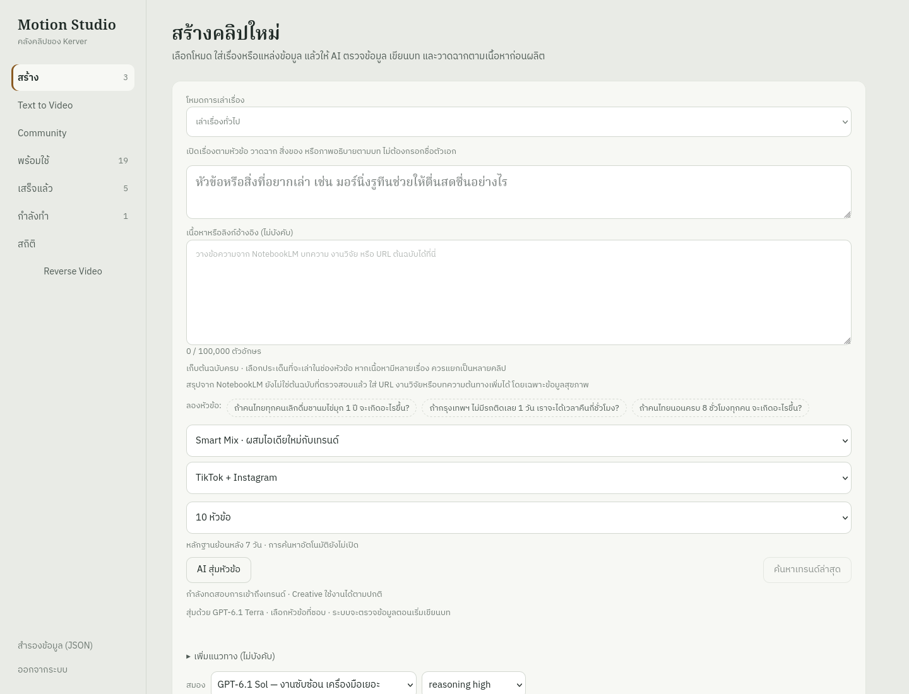

# Trend Research validation — 14 November 2026

**The implementation is deployed behind disabled research flags. Full acceptance
has not passed. No TikTok or Instagram source is claimed as verified or supported.**

## Repository and deployed versions

- Repository: https://github.com/kerverme/motion-studio
- Feature branch: `feat/jev-trend-research`.
- Main inspected again on 14 November: `4c0e9ed3ac8ffd61e83a34cfe12e14ce30673ad1`.
- Preserved newer production baseline: `eba715cad26e0d9b3c1d11d7a48aa4980a4ae1f3`
  from `codex/prompt-ab-sol-20261114`. No main reset or old worker deployment.
- Feature commits:
  - `6349c03d9ec8ae86fa8825b9e2b26646e798ebeb`: isolated adapter, ledger and migration.
  - `6bd191cb51d023120daeb38e32e49c3d1f8ef5bb`: container import validation and discovery.
  - `848cb80ef75ca23bbdb6bc5ed7468806c401a553`: Thai topic UI and script evidence.
  - `52e55cada40be6fcf3c07da957bfbcdf4ac011da`: bounded longer polling and usage reconciliation.
  - `27e3d8a6bf57e527f55ed2e836487a86b8ccc183`: merge the latest Reverse deployment
    and reconcile topic costs when a previous API release finishes the request.
- API production deployment: `4f28bca9-a45b-4881-a7ae-f11bf261a502`, SUCCESS at `27e3d8a`.
- Research worker deployment: `6f8794c4-37f8-48f2-b30e-e9b398aaa2f8`, SUCCESS at `27e3d8a`.
- Research service: `jev-trend-research`, `5d5e1bc3-42f9-429c-b86c-84b983abaa2d`.
- Railway project: `d8173477-9d20-43bf-b0a6-692fed643f0f`; environment:
  `eb069d56-ef1e-4789-9137-bc26615ed28d`.
- Jev: v0.1.13 / `2058ea22ad5d6586e1339029bc0cc2715637e0b9` (MIT).
- Socai: v0.6.18 / `340b9d7b65533a535bafded02659f76fb8b75cb3` (Apache-2.0).

All seven Railway services were Online, with no pending environment changes, after
the final API rollout and browser verification. The worker's first build failed because copied API
modules lacked their ESM package context; this was fixed and validated in later
container builds. Railway still lists that historical failed deployment.

## Changed files

The feature adds `api/migrations/030_trend_research.sql`,
`api/src/trends/{policy,store,notion,provider,routes}.ts`,
`api/src/{trends,trend-script}.test.ts`, and the independent `trend-worker/` package,
Dockerfile, pinned lockfile, Socai build patch, adapter, worker and tests.

It updates `api/src/{topic-suggestions,studio}.ts`, `api/src/ui.html`,
`api/src/{topic-suggestions,general-route}.test.ts`, and `docs/trends/`.
The earlier Reverse changes are part of the preserved baseline, not changes made
for this feature. Motion, Lemo, ElevenLabs, fal and Buffer provider defaults remain
unchanged. No media generation or publication was initiated by these tests.

## Automated and UI verification

| Check | Actual result | Scope |
|---|---|---|
| API TypeScript | Passed | Existing and new API code |
| Full API suite | 161/161 passed | Includes merged Reverse tests, SQL-backed policy, dedup and mocked provider tests |
| Research worker TypeScript | Passed | Adapter and worker |
| Research adapter tests | 2/2 passed | Observed dates, exact/null metrics and platform payloads |
| Pinned Jev upstream tests | 224/224 passed | Linux container with init process |
| Container build/import test | Passed | Real Railway image and Socai Linux binary |
| Local UI regression | Passed, zero JS errors | Paid POSTs mocked; evidence selection/rewrite guards also covered in API tests |
| Actual production UI | Passed, zero JS errors | No mocked responses and no mutation requests |
| HTTPS / API health | HTTP 200, database up | Existing Buffer and Notion configuration present |
| Migration | Applied through the worker/API migration lock | New SQL-backed routes and durable jobs worked; additive tables retained |

The final production browser check at 07:11:05 UTC (14:11:05 Bangkok) confirmed Smart Mix
as default, 10 topics, selectable GPT-6.1 Sol, correct general/name-story fields,
optional characters, visible Classic/Lemo engines, Text to Video and Ready pages.
It resumed the existing real Trending request by GET, showed the correct empty
evidence warning, and sent no new generation request. No production video rendering
or publishing was rerun; those are not claimed as newly end-to-end verified.

## Real external tests

Times below are UTC; add seven hours for Bangkok. Research evidence is empty —
there are no sample verified source URLs or dates to provide truthfully.

| Test / durable ID | Time | Actual result |
|---|---|---|
| TikTok small discovery `8a17f215-dc11-4d22-9f3d-ff17a08fdc1f` | 06:27–06:29 | OpenAI exceeded the former two-minute limit; cancellation confirmed; zero sources |
| Instagram small discovery `172529f1-e771-4371-8bc4-8bfd5e627a74` | 06:29–06:31 | Same timeout/cancellation; zero sources |
| TikTok public guest read `de6f1a1f-8408-484d-b287-21e022546217` | 06:38:12–06:38:37 | One browser action; `login_required`; no paid LLM call |
| Instagram public guest read `847089c7-f9b4-4f27-ba7f-8c9a714589d7` | 06:38:42–06:38:43 | One browser action; `net::ERR_HTTP_RESPONSE_CODE_FAILURE`; no paid LLM call |
| Trending empty-evidence request `90f3bdfe-3b92-45f0-af73-b5e31eacfbf4` | 06:39 | Completed with zero ideas and a Thai warning; no OpenAI call |
| Smart Mix / Terra `19da61b2-6e3f-447c-bbd0-eebc46d61b6d` | 06:39–06:42 | Former three-minute timeout; cancellation confirmed |
| Smart Mix / Terra bounded retry `b2299f12-6b9c-4253-a365-0df155013149` | Submitted 06:51:49; failed by 07:04 | Submitted once; concurrent API deployment at 06:59 resumed its saved response and then cancelled under that release's three-minute timeout |

The retry is **not a clean ten-minute timeout test**: another deployment interrupted
it. Its saved response `resp_015fa71f0bad8412006af80505f95487d2b6a8f2dded166f4e`
was reconciled by GET at 07:08:44 UTC: cancelled, zero tokens, estimated $0. No new
topic request was posted to compensate. The concurrent Reverse update was merged
byte-for-byte into `27e3d8a` before the final rollout.

The new background topic deadline is ten minutes, bounded to 3–15 minutes by
configuration. Research provider calls allow five minutes within the overall
ten-minute job deadline. Accepted requests are checkpointed; disconnected clients
poll existing IDs. Usage reconciliation only reads responses and never creates
replacement paid requests.

## Notion and remaining acceptance gates

Created database:
https://www.notion.so/41875d42f42b8193bfc0f9458b2f69fc

All 21 requested properties exist. The connected Notion MCP can access the new
database, but the Studio runtime integration returned **HTTP 404**. Existing
Episodes synchronization still reported 25/25 successful, so the new database
needs to be connected to that same integration. No token should be pasted into
chat. No synthetic production research pages were created to simulate success.

These gates remain unpassed:

1. Authorized, reliably accessible TikTok or Instagram evidence capture.
2. A successful runtime Notion write and subsequent deduplicated update.
3. An eligible real source used by Terra, displayed in the UI, and selected into a
   draft whose existing fact-checker reopens the source.
4. A larger controlled research test and six-hour scheduling acceptance.
5. Live Creative generation completion while the provider is not timing out.

The seven-day filtering, null metrics, older-post growth, stable identity upsert,
ambiguous Notion creation, source selection, script recheck and no-duplicate-paid-
request behavior passed automated tests. These are not substitutes for the live
acceptance path above. Phase-one concurrency is fixed at one distributed worker;
raising concurrency requires a further reviewed implementation. Timeout, step,
score and daily budget limits are configurable; read retry counts are bounded.

## Costs

All four cancelled OpenAI responses were read back from the provider:
each reported zero input/output tokens and an estimated $0. Actual invoice amounts
were not inspected. Guest probes, empty Trending fallback and UI verification
made no paid LLM creates. This is an observed usage result, not a claim that research
is free or that successful model calls will cost zero.

The ledger uses Terra estimates of $1/M input, $5/M output and $0.05/M cached input,
plus an estimated $0.01 per hosted search. These are configured estimates, not an
invoice. For illustration, 3,000 uncached input plus 5,000 output tokens would be
$0.028; an actual research job may involve several model and search calls.
The research budget is set to $2/day, reserves $0.12 per pending call, and is not
a provider invoice guarantee. Scheduling is disabled, so no recurring research
calls are currently authorized by the scheduler.

Railway compute remains additional even with scheduling off. The worker's one-hour
sample had 0.0064 average CPU and 0.0658 GB average memory, with 0.2211 CPU / 0.4145 GB
peaks during the limited tests. These measurements do not establish full research
load or the monthly bill. No fal, ElevenLabs, paid Firecrawl or Buffer production
operations were invoked by this integration test.

[Railway's published container rates](https://docs.railway.com/pricing/plans#resource-usage-pricing)
checked on 14 November are $10/GB-month RAM, $20/vCPU-month and $0.05/GB egress.
If the measured one-hour average remained unchanged for an entire month, CPU/RAM
alone would be about $0.79 (`0.0658 * 10 + 0.0064 * 20`). This is an extrapolation
of mostly idle/small-probe behavior, not a production load estimate or total bill;
base plan, other Studio services, egress and real scheduled research are excluded.

## Production controls and rollback

`MOTION_TREND_RESEARCH_ENABLED=0`, `TREND_RESEARCH_SCHEDULE_ENABLED=0`,
`TREND_VERIFIED_PLATFORMS` is empty, and bootstrap test requests are cleared.
The topic UI is deployed, but verified trend use and recurring collection remain
disabled until the acceptance path works. Do not advertise TikTok/Instagram support
from CLI capabilities alone.

Connect the Notion database to the existing Studio integration and arrange an
authorized supported social access method without exposing sessions or bypassing
access controls. Then resume one bounded real research run before larger testing.
Do not reuse a failed request by blindly posting it again.

For rollback, keep both flags disabled and retain all research history. If reverting
the API is necessary, inspect current production first and choose the latest
compatible baseline; the latest pre-feature API was `17e1dc73-d428-4a4c-9d78-ac2f2bdba28e`
at `eba715c`. Do not reset main, drop tables, or redeploy old Motion/Lemo workers.
Detailed installation, score rules and controls are in [OPERATIONS.md](OPERATIONS.md).
